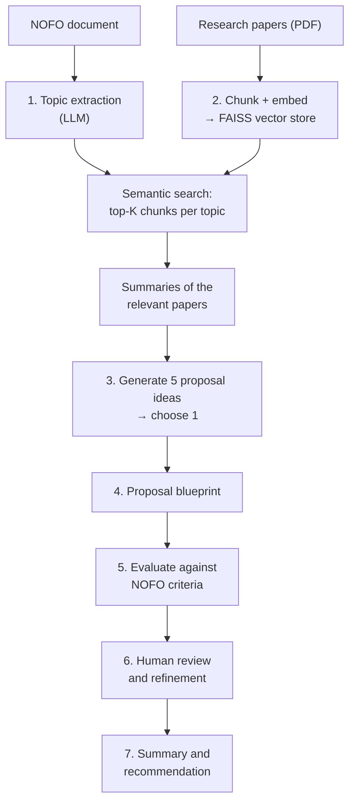

<div align="center">

# 📝 AI Research Proposal Assistant

**An LLM + RAG system that helps write a research proposal aligned with an NIH funding opportunity**

<p>
  
  
  
  
  
  
</p>

</div>

---

## 📌 Overview

Writing a strong research proposal means reading the funding call closely, reviewing the literature, coming up with ideas that fit, and checking the draft against the review criteria. This project builds an **AI assistant that supports each of those steps**, for a proposal responding to an NIH **Notice of Funding Opportunity (NOFO)**.

It was the final project of the **Johns Hopkins University Certificate Program in Applied Generative AI**.

## 🧠 Workflow



| Step | What happens |
|---|---|
| **1. Topic extraction** | The LLM reads the NOFO and extracts the key research topics it asks for |
| **2. Relevance assessment** | Papers are loaded and chunked, embedded and stored in a **FAISS** index. The most relevant chunks for each topic are retrieved and summarized |
| **3. Ideation** | Five proposal ideas are generated from the filtered research, and the best one is developed in detail |
| **4. Blueprint** | A structured outline of the chosen proposal |
| **5. Evaluation** | The draft is scored against the NOFO's review criteria, with specific recommendations |
| **6. Human review** | Feedback is applied to refine the proposal |
| **7. Summary** | Final summary and recommendation |

## 🛠️ Tech stack

| Component | Tool |
|---|---|
| Orchestration | [LangChain](https://www.langchain.com/) |
| LLM | OpenAI `gpt-4o-mini` |
| Document loading | `PyPDFLoader` + `RecursiveCharacterTextSplitter` |
| Embeddings | `sentence-transformers/all-MiniLM-L6-v2` (Hugging Face) |
| Vector store | [FAISS](https://github.com/facebookresearch/faiss) |
| Environment | Google Colab + Google Drive |

## 📂 Repository structure

```
├── JHU_AGAI_Final_Project_Solution.ipynb   # the full seven-step workflow
└── README.md
```

## 🚀 Getting started

```bash
# 1. Clone the repository
git clone https://github.com/hamidghasemi69/JH-Final-Poroject.git
cd JH-Final-Poroject

# 2. (Recommended) create a virtual environment
python -m venv .venv && source .venv/bin/activate
pip install langchain langchain-openai langchain-community langchain-text-splitters faiss-cpu sentence-transformers pypdf jupyter

# Provide your own API key (never commit it)
export OPENAI_API_KEY="sk-..."

# 3. Launch the notebook
jupyter notebook JHU_AGAI_Final_Project_Solution.ipynb
```

> The notebook was written for Google Colab and reads papers from a Google Drive folder. Update the file paths to point to your own NOFO and PDF papers.

## 🙏 Acknowledgements

- **Johns Hopkins University**, Certificate Program in Applied Generative AI
- [LangChain](https://www.langchain.com/), [FAISS](https://github.com/facebookresearch/faiss) and [Sentence-Transformers](https://www.sbert.net/)

## 👤 Author

**Hamidreza Ghasemi** · Principal Data Scientist @ Arizona State University

[](https://hamidghasemi69.github.io)
[](https://www.linkedin.com/in/hamidghasemi69/)
[](https://github.com/hamidghasemi69)

<sub>If you find this project useful, consider giving it a ⭐</sub>
